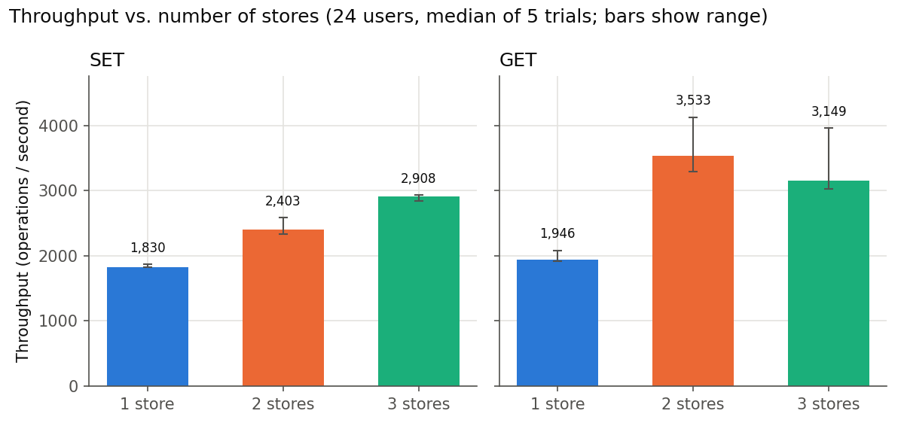
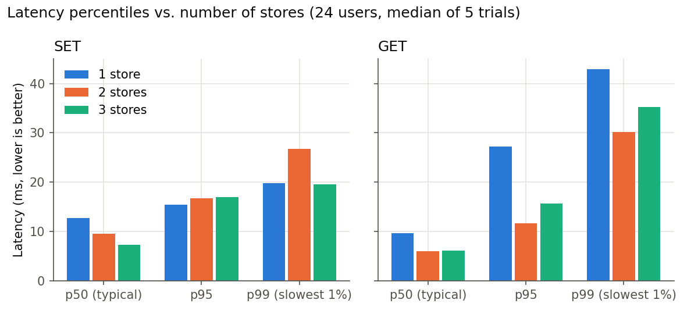
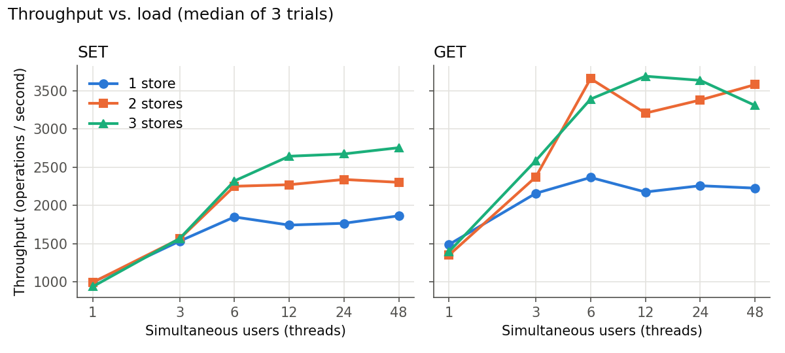

# Scaling a Key-Value Store with Consistent Hashing

**CSCI 5144, Coding Assignment 2** · Norah Haque, Aymah · November 2026

## 1. Introduction

In Assignment 1 we built a single-server key-value (KV) store in Python and Flask. It supports GET, PUT and DELETE over HTTP, handles concurrent requests with a lock, and makes every write durable with an append-only log (AOF) that is flushed to disk with `fsync` before the server replies. All requests to a single server queue behind one lock and one disk, so throughput is limited no matter how many clients there are.

In this assignment we spread the load across up to three copies of that store. Each store runs in its own Docker container, and a client uses consistent hashing to send every key to exactly one store. We measured throughput and latency with one, two and three stores, showed that stores can be added and removed without losing data, and investigated why scaling falls short of the ideal on a single laptop.

## 2. Background

**Sharding.** To serve more requests than one server can handle, the data is split into parts called shards, each held by a different server. A rule decides which server owns each key, and that rule must give every client the same answer.

**Modulo hashing vs. consistent hashing.** The simplest rule is `hash(key) % N`, where N is the number of servers. It spreads keys evenly, but when N changes almost every key's owner changes: going from 3 to 4 servers moves about 75% of the data. Consistent hashing avoids this. Server positions and keys are hashed onto the same circular number range (the ring), and each key belongs to the first server found by moving clockwise from the key's position. Adding a server takes over only the keys just before its positions, so about 1/N of keys move and the rest stay where they are.

**Virtual nodes.** With one position per server, the gaps between servers on the ring are random and uneven, so one server can end up with far more keys than another. Giving each server many positions (virtual nodes) averages out those gaps.

**Containers.** A Docker container runs a program in an isolated environment with its own filesystem, network address and resource limits. Running three containers from the same image approximates three small independent machines. Docker Compose starts and stops a group of containers described in one file.

## 3. Design

```
  kv_bench.py / rebalance.py / check_cluster.py
                 │ uses
           kv_client.py ──uses──> hash_ring.py      "key_42 belongs to kv2"
                 │ HTTP
      ┌──────────┼──────────┐
     kv1        kv2        kv3        (Docker containers, 1 CPU each,
  kv_server  kv_server  kv_server      each with its own data volume)
```

**Client-side routing.** The stores are unmodified Assignment 1 servers that do not know about each other. Routing happens in the client: `kv_client.py` holds the list of stores and the hash ring, picks the owner of each key, and sends the request directly to it. We considered a central router that would forward every request, but rejected it because it adds a second network hop to every request and, as a single Python process, would itself become the bottleneck we were trying to remove. Client-side routing is also the approach used by memcached clients and Redis Cluster.

**The hash ring.** We wrote our own ring (`hash_ring.py`, about 40 lines of logic) instead of using a library. Each store is placed on the ring at 500 positions by hashing `"<store URL>#0"` through `"<store URL>#499"`. Positions are kept in a sorted list, and a key's owner is found by binary search (`bisect`) for the first position after the key's hash, wrapping around at the end. We hash with MD5 rather than Python's built-in `hash()`, because Python randomizes string hashing each time it starts and two programs would then disagree about where keys live. We chose 500 virtual nodes by measurement (Section 6.1).

**Changing the number of stores.** When a store is added or removed, `rebalance.py` asks each existing store for its keys through a new `GET /` endpoint, checks each key's owner under the new ring, and moves only the keys whose owner changed. Each key is copied to its new owner before it is deleted from the old one, so it always exists in at least one place. A removed store is drained while it is still running and stopped afterwards.

**Server changes.** We made two small additions to the Assignment 1 server. `GET /` returns the list of keys on that store and also serves as a health check for scripts waiting for a container to start. A `--log-level` option turns off per-request logging during benchmarks, so that we measure the store and not the cost of writing log lines.

**Containers and fairness.** `docker-compose.yml` defines three stores (ports 8081–8083), each limited to one CPU and given its own named volume for its AOF. The CPU limit makes each container behave like a separate one-CPU machine, so moving from one to three stores adds a fixed, known amount of capacity.

## 4. Implementation

| File | Role |
| --- | --- |
| `hash_ring.py` | Consistent hash ring: add/remove a store, find the owner of a key |
| `kv_server.py` | One store (Assignment 1 code plus `GET /` and `--log-level`) |
| `kv_client.py` | `ShardedKVClient`: get/put/delete routed through the ring; direct per-store calls for rebalancing |
| `rebalance.py` | Moves keys after a store is added or removed; includes a live demo |
| `check_cluster.py` | End-to-end check against running containers (placement, read-back, delete) |
| `kv_bench.py` | Multi-process, multi-threaded benchmark writing results to CSV |
| `analyze_hashing.py` | Offline experiment on key balance and key movement |
| `run_experiments.sh` | Runs every benchmark configuration and trial |
| `plot_results.py` | Produces the figures and summary tables |
| `Dockerfile`, `docker-compose.yml` | Store image; three store containers and a benchmark container |
| `test_kv.py`, `test_hash_ring.py` | 13 unit tests for the store and the ring |

A request flows as follows. The client hashes the key, finds the next position on the ring and so the owning store, URL-encodes the key, and sends the HTTP request to that store over a connection reused from a per-thread pool. The store takes its lock, appends the operation to its AOF, calls `fsync`, updates its in-memory dictionary and replies. Only the owning store is involved, so different stores serve different keys in parallel. Because a key always maps to the same store, concurrent writes to one key still meet at a single lock, and the last-writer-wins guarantee from Assignment 1 is preserved.

## 5. Experimental Setup

All experiments ran on one MacBook with an Apple M3 (4 performance and 4 efficiency cores) and 8 GB of RAM, plugged in with Low Power Mode off. Docker Desktop 28.4 was given 6 CPUs and 4 GB. Each store container was limited to 1 CPU, and the benchmark ran in its own container limited to 2 CPUs, leaving 1 CPU for Docker itself.

The benchmark simulates concurrent users. Each thread repeatedly takes the next key from a shared queue, sends one request, waits for the reply and records the time it took. A SET phase writes every key, and a GET phase reads every key back and checks its value. Before timing starts, each thread opens a connection to every store, so connection setup is not counted. Users are split across two processes because one Python process can only run Python code on about one core at a time. Throughput is successful operations divided by elapsed time, and latency is reported as the average and the 50th, 95th and 99th percentiles.

The main experiment used 24 users and 10,000 keys with one, two and three stores, five trials each. Every trial began from empty stores. Trials formed the outer loop (1, 2, 3, 1, 2, 3, …) so that any change in background load over time affected all configurations equally. A sweep then varied the number of users from 1 to 48 (6,000 keys, three trials). We report medians, with the range across trials where useful. All 138 measurements completed with zero errors.

## 6. Results

### 6.1 Key distribution and key movement

These results come from `analyze_hashing.py` with 100,000 keys and need no servers.

| Virtual nodes per store | Store 1 | Store 2 | Store 3 | Busiest ÷ quietest |
| --- | --- | --- | --- | --- |
| 1 | 48.6% | 40.3% | 11.2% | 4.35× |
| 10 | 27.4% | 18.6% | 54.0% | 2.90× |
| 100 | 36.6% | 29.2% | 34.2% | 1.26× |
| **500** | **33.9%** | **34.5%** | **31.6%** | **1.09×** |

| Change | Ideal | Modulo hashing | Consistent hashing |
| --- | --- | --- | --- |
| 2 → 3 stores | 33.3% | 66.7% | 31.6% |
| 3 → 4 stores | 25.0% | 75.1% | 24.2% |

With 500 virtual nodes the busiest store holds only 9% more keys than the quietest. In the benchmark the split was 3,417 / 3,279 / 3,304 keys. When a store is added, consistent hashing moves close to the minimum possible fraction of keys, while modulo hashing moves two to three times as many.

### 6.2 Adding and removing stores

We wrote 3,000 keys to two stores and then added a third. Before rebalancing, only 2,088 keys could be found, because the ring now assigned the other 912 to the empty new store. Rebalancing moved exactly those 912 keys (30.4%), after which all 3,000 were readable. We then removed the second store: its 1,072 keys (35.7%) moved to the other two, and again all 3,000 were readable. No keys were lost in either direction.

### 6.3 Throughput and latency



| Phase | Stores | Throughput (ops/s) | Speedup | p50 (ms) | p95 (ms) | p99 (ms) |
| --- | --- | --- | --- | --- | --- | --- |
| SET | 1 | 1,830 | 1.00× | 12.7 | 15.4 | 19.8 |
| SET | 2 | 2,403 | 1.31× | 9.6 | 16.8 | 26.8 |
| SET | 3 | 2,908 | 1.59× | 7.3 | 17.0 | 19.5 |
| GET | 1 | 1,946 | 1.00× | 9.6 | 27.2 | 42.9 |
| GET | 2 | 3,533 | 1.82× | 6.1 | 11.7 | 30.2 |
| GET | 3 | 3,149 | 1.62× | 6.1 | 15.7 | 35.2 |



Write throughput rose steadily with each added store, reaching 1.59× with three stores, and was very consistent across trials (for example, 2,846 to 2,931 ops/s for three stores). Read throughput rose 1.82× with two stores but did not improve further with three. Median latency fell for both operations, from 12.7 ms to 7.3 ms for writes and from 9.6 ms to about 6 ms for reads. Tail latency behaved differently: read p95 fell sharply, while write p95 and p99 did not improve.

### 6.4 Behavior under increasing load



With a single user, all three configurations performed the same (about 990 writes/s), since one outstanding request keeps only one store busy at a time. From about six users the curves separate, and each flattens at that configuration's capacity. For writes, the ceilings are ordered clearly by the number of stores. For reads, the two-store and three-store curves overlap above six users. The curves have flattened by 24 users, which confirms that 24 was a sufficient load for the main experiment.

## 7. Analysis

**Why more stores help.** Each store serializes its writes through one lock and one `fsync`. Splitting the keys gives each store a shorter queue, so each request waits less, and Little's Law turns lower latency into higher throughput. In a closed-loop benchmark with 24 users, exactly 24 requests are in progress at all times, so throughput should equal 24 divided by the average latency. Our measurements match this within 0.4% in all six configurations (for example, 2,908 ops/s measured against 2,916 predicted for three-store writes). This consistency check shows that the throughput gains come from reduced waiting, not from measurement artifacts.

**Why writes scale to 1.59× rather than 3×.** The containers have separate CPUs but share one physical SSD. In a direct test, one container performed 1,637 fsyncs per second alone, while three containers running together managed 908 each, 2,724 in total, or only 1.66× the single-container rate. Since every write requires an `fsync`, the shared disk caps write scaling just above what we observed. The same effect explains why write tail latency did not improve: an occasional slow `fsync` on the shared disk delays requests on every store at once.

**Why reads stop at two stores.** Reads do not touch the disk, so they are limited by CPU. During three-store reads, each store used 75–88% of its CPU and the benchmark used about two full cores. With Docker's own networking, this is more than the M3's four performance cores, so part of the work ran on the much slower efficiency cores. We first suspected that the benchmark was the bottleneck, and gave it three processes and three CPUs to test this. Read throughput rose by 12% with two stores and 25% with three, but three stores still only matched two (3,945 and 3,968 ops/s). The read ceiling is therefore the laptop as a whole: the stores, the benchmark and Docker compete for the same fast cores. On separate machines, each store would have its own CPU and disk.

## 8. Challenges

**The first benchmark made more stores look slower.** Run from macOS, the benchmark measured 818 writes/s with one store and 503 with three. CPU sampling showed the stores were only 45–78% busy, while Docker Desktop's port forwarding, which carries every request from the Mac into its Linux virtual machine, used about 150% CPU. We moved the benchmark into a container on the same Docker network, so requests travel container-to-container, and split it across processes to avoid Python's one-core limit. After this change, scaling appeared.

**Results varied widely between runs.** Early runs of the same configuration differed by almost 2× (for example, 558 and 997 writes/s). The laptop was on battery in Low Power Mode, which slows the CPU. Running plugged in with Low Power Mode off, closing other applications, and using five interleaved trials reduced the spread to a few percent and roughly doubled single-store throughput.

**Isolating the remaining bottlenecks.** Writes and reads stopped scaling for different reasons, and we tested each hypothesis rather than assuming one. We ruled out Docker's CPU throttling (under 0.6 seconds of throttling per 70-second run), measured the shared-disk effect directly with the `fsync` test, and tested the benchmark-bottleneck hypothesis with a stronger benchmark, which showed it was only part of the explanation.

**Smaller issues.** With 100 virtual nodes, store loads differed by 26%, so we measured and chose 500. A health-check route at `/_health` would have conflicted with the key route `/<key>`, so we used the bare `/` instead. Keys containing spaces, `?` or `/` would have broken request URLs, so the client URL-encodes keys. Rebalancing needed to address specific stores rather than the ring's choice, so the client gained direct per-store methods.

## 9. Limitations and Future Work

All three stores share one machine, its four fast cores and one SSD, so these results underestimate what separate servers would achieve. Rebalancing assumes no client traffic during the move, since a client using the old ring could look for a key on its old store after it has moved. It is also sequential, taking 8 to 20 seconds for about 1,000 keys. Each key is stored once, so losing a store loses its keys. Natural next steps are replicating each key to the next store on the ring for fault tolerance, moving keys in parallel during rebalancing, identifying stores by name rather than URL on the ring, and repeating the experiment on separate machines.

## 10. Conclusion

Consistent hashing with 500 virtual nodes split keys almost evenly across three containerized stores, moved only about a third of keys when a store was added, and allowed stores to be added and removed with no data loss. Throughput improved by 1.59× for writes and up to 1.82× for reads, and median latency fell by 36–43%. The gap from ideal scaling is explained by measured, shared physical resources, the SSD for writes and the laptop's fast CPU cores for reads, rather than by the design. The measurements are internally consistent, matching Little's Law within 0.4%.

## Appendix: Reproducing the Results

See `README.md`. In short: `docker compose up -d --build`, then `./run_experiments.sh` (about 25 minutes), then `python plot_results.py`. Raw data is in `results/*.csv`, and the diagnostic measurements are in `results/diagnostics.md`.
